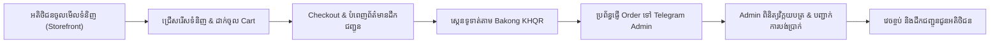
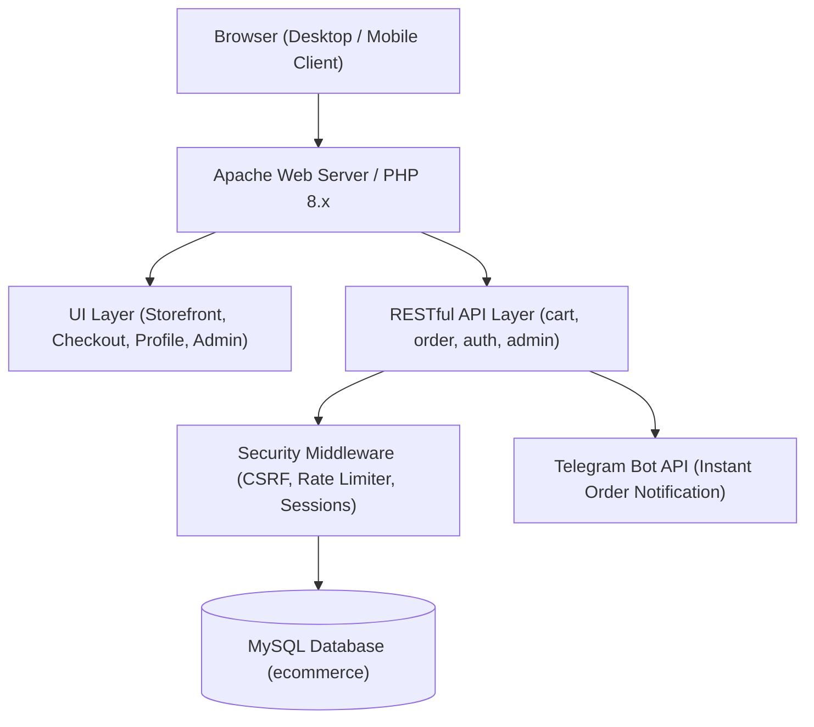
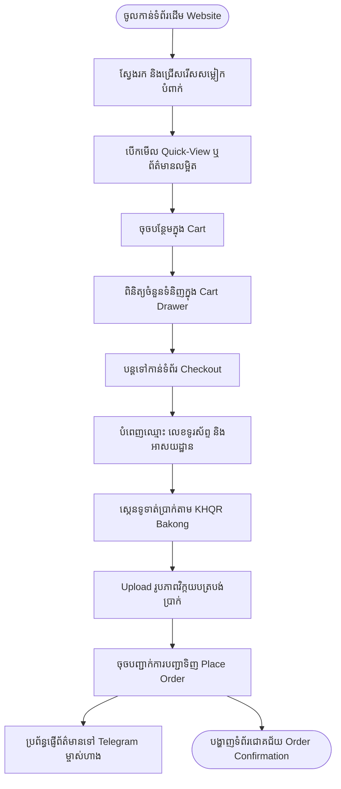
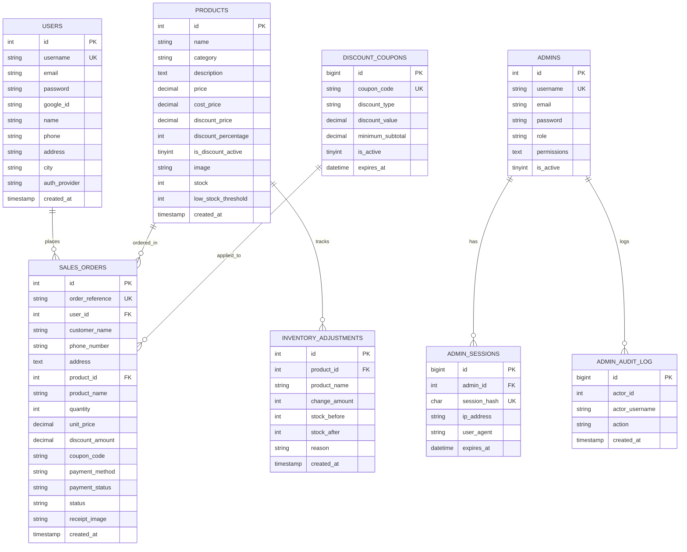

# 📘 សៀវភៅគម្រោងបញ្ចប់ការសិក្សា (E-Commerce Project Book)
## ប្រព័ន្ធគ្រប់គ្រង និងលក់សម្លៀកបំពាក់ទាន់សម័យតាមប្រព័ន្ធអេឡិចត្រូនិក
### SN STORE E-COMMERCE PLATFORM

---

## 1. COVER (ទំព័រក្របមុខ)

* **ឈ្មោះគម្រោង (Project Name):** SN STORE • Modern Fashion E-Commerce Platform
* **មុខវិជ្ជា (Subject):** Web Development & Database Engineering (E-Commerce Project)
* **កម្រិតសិក្សា (Level):** ថ្នាក់បរិញ្ញាបត្រ / បរិញ្ញាបត្ររងផ្នែកវិទ្យាសាស្ត្រកុំព្យូទ័រ (Computer Science / IT)
* **សមាជិកក្រុម / អ្នករៀបចំ (Team Work / Authors):**
  1. **REM Sonich (រ៉ែម ស៊ុននិច)** — Team Leader & Full Stack System Architect (GitHub: `remsonich`)
  2. **NHO Net (ញ៉ូ ណេត)** — Backend & Database Developer
  3. **ឆៃ សោភា (CHHAI Sophea)** — Frontend Developer & UI/UX Designer
  4. **SAO Ramorn (សៅ រ៉ាម៉ន)** — Quality Assurance (QA) & System Testing
* **សាស្ត្រាចារ្យណែនាំ (Lecturer / Advisor):** លោកគ្រូ / អ្នកគ្រូប្រចាំមុខវិជ្ជា E-Commerce System
* **ឆ្នាំសិក្សា (Academic Year):** 2026 - 2027
* **កាលបរិច្ឆេទដាក់ជូន (Submission):** សប្តាហ៍ទី ៨ (Midterm 1) & សប្តាហ៍ទី ១៤ (Final Implementation)

---

## 1. INTRODUCTION (សេចក្តីផ្តើម)

### 1.1 Project Name (ឈ្មោះគម្រោង)
**SN STORE** — វេបសាយពាណិជ្ជកម្មអេឡិចត្រូនិចលក់សម្លៀកបំពាក់ និងគ្រឿងតុបតែងម៉ូដទាន់សម័យ (Modern Curated Fashion Storefront & Backoffice System)។

### 1.2 Project Description (ការពិពណ៌នាអំពីគម្រោង)
SN STORE គឺជាប្រព័ន្ធ E-Commerce ពេញលេញមួយ (Full-stack Web Application) ដែលត្រូវបានបង្កើតឡើងដើម្បីផ្តល់នូវបទពិសោធន៍ទិញទំនិញតាមអនឡាញដ៏ទំនើប ងាយស្រួល និងមានសុវត្ថិភាពខ្ពស់។ ប្រព័ន្ធនេះចែកចេញជា ២ ផ្នែកសំខាន់ៗ៖
1. **Storefront (Client-facing UI):** សម្រាប់អតិថិជនស្វែងរកទំនិញ, មើលព័ត៌មានលម្អិត, គណនាភាគរយបញ្ចុះតម្លៃ, ដាក់ទំនិញក្នុងរទេះ, ធ្វើការកុម្ម៉ង់ទិញ និងទូទាត់ប្រាក់តាមប្រព័ន្ធបាគង KHQR។
2. **Backoffice Admin Panel:** សម្រាប់ម្ចាស់ហាងគ្រប់គ្រងទំនិញ, ស្តុក, ការបញ្ជាទិញ, ការផ្ទៀងផ្ទាត់ការទូទាត់, អតិថិជន, របាយការណ៍ហិរញ្ញវត្ថុ និងខ្លឹមសារគេហទំព័រទាំង ២ ភាសា (ខ្មែរ-អង់គ្លេស)។

### 1.3 Project Objectives (គោលបំណងនៃគម្រោង)
* **ល្បឿន និងភាពងាយស្រួល (Performance & Usability):** បង្កើតវេបសាយដែលមានល្បឿន Render លឿនក្រោម ១ វិនាទី (Sub-second load time) ដោយមិនប្រើប្រាស់ Library UI ធ្ងន់ៗដែលនាំឱ្យយឺត។
* **ការឆ្លើយតបគ្រប់ឧបករណ៍ (100% Responsive Design):** ធានាការបង្ហាញរូបរាងឥតខ្ចោះលើទូរស័ព្ទដៃ, ថេប្លេត និងកុំព្យូទ័រ។
* **សមាហរណកម្មប្រព័ន្ធទូទាត់ក្នុងស្រុក (Local Payment Integration):** គាំទ្រការទូទាត់តាមស្តង់ដារបាគង KHQR របស់ធនាគារជាតិនៃកម្ពុជា ជាមួយ Mock Simulation & Receipt Verification។
* **ប្រព័ន្ធពហុភាសា & ស្បែកពណ៌ (i18n & Theming):** គាំទ្រភាសាខ្មែរ-អង់គ្លេស និងការប្តូរពន្លឺ Light/Dark Mode ដោយគ្មានការព្រិចភ្នែក (Zero Flash)។

### 1.4 Target Customer (អតិថិជនគោលដៅ)
* យុវវ័យ សិស្ស និស្សិត និងបុគ្គលិកធ្វើការដែលមានបំណងទិញសម្លៀកបំពាក់ទាន់សម័យប្រកបដោយទំនុកចិត្ត និងរហ័សទាន់ចិត្ត។
* អ្នកទិញទំនិញតាមទូរស័ព្ទដៃ (Mobile Shoppers) ដែលចូលចិត្តការស្កេនទូទាត់ប្រាក់តាម KHQR ដោយផ្ទាល់ពី Mobile Banking App។

---

## 2. BUSINESS & E-COMMERCE (អាជីវកម្ម និងគំរូពាណិជ្ជកម្មអេឡិចត្រូនិក)

### 2.1 Business Idea (គំនិតអាជីវកម្ម)
ទីផ្សារសម្លៀកបំពាក់នៅកម្ពុជាបច្ចុប្បន្នកំពុងមានការរីកចម្រើនយ៉ាងឆាប់រហ័ស ប៉ុន្តែអាជីវកម្មភាគច្រើននៅតែលក់តាមរយៈបណ្តាញសង្គម (Facebook/Telegram) ដោយការឆាតដោយដៃ ដែលជួបការលំបាកក្នុងការគ្រប់គ្រងស្តុក និងការផ្ទៀងផ្ទាត់វិក្កយបត្រ។ SN STORE ត្រូវបានបង្កើតឡើងដើម្បីធ្វើស្វ័យប្រវត្តិកម្មនៃការលក់ ដោយអតិថិជនអាចជ្រើសរើសទំនិញ មើលស្តុកជាក់ស្តែង បង់ប្រាក់តាម KHQR និងទទួលការជូនដំណឹងតាម Telegram ដោយស្វ័យប្រវត្តិ។

### 2.2 E-Commerce Model (គំរូពាណិជ្ជកម្ម)
* **Model:** **B2C (Business-to-Consumer)**
* អាជីវកម្ម SN STORE លក់ផលិតផលម៉ូដសម្លៀកបំពាក់ដោយផ្ទាល់ទៅកាន់អ្នកប្រើប្រាស់ចុងក្រោយ (Direct Retail to End Consumers)។

### 2.3 Products & Services (ផលិតផល និងសេវាកម្ម)
* **Men's Fashion:** អាវយឺត, អាវសាច់ក្រណាត់ Flannel, ខោខូវប៊យ, ស្បែកជើង Suede Chelsea Boots។
* **Women's Fashion:** រ៉ូប, អាវយឺតដៃវែង Turtleneck, អាវវាល Lace Trim, ខោខូវប៊យទាន់សម័យ។
* **Accessories:** កាបូប, ខ្សែក្រវាត់, វ៉ែនតា, មួកម៉ូដ។
* **Digital Goods / Gift Cards:** ប័ណ្ណបញ្ចុះតម្លៃ និងគូប៉ុងពិសេស (Discount Coupons)។
* **Customer Support:** សេវាបម្រើអតិថិជន ២៤/៧ តាមទម្រង់ Contact Form និង Telegram Direct Chat។

### 2.4 Main Business Process (ដំណើរការអាជីវកម្មគោល)


---

## 3. SYSTEM REQUIREMENTS (តម្រូវការប្រព័ន្ធ)

### 3.1 Functional Requirements (តម្រូវការមុខងារ)
* **FR-01 (Product Browsing & Filtering):** អតិថិជនអាចមើលកាតាឡុកទំនិញ, ស្វែងរកតាមឈ្មោះ, និងចម្រាញ់តាមប្រភេទ (Men, Women, Accessories)។
* **FR-02 (Cart & Checkout):** អតិថិជនអាចបន្ថែមទំនិញក្នុងរទេះ, កែប្រែចំនួន (+/-), បញ្ចូលលេខកូដបញ្ចុះតម្លៃ (Coupon), និង Checkout។
* **FR-03 (Payment Simulation):** បង្ហាញលេខកូដ QR ស្តង់ដារ KHQR Bakong និងទទួលការ Upload រូបភាពវិក្កយបត្របង់ប្រាក់។
* **FR-04 (User Authentication):** ចុះឈ្មោះគណនីថ្មី, ចូលប្រើប្រាស់តាម Email/Password, ចូលតាម Google GIS 1-Click, និងទំព័រ Profile ផ្ទាល់ខ្លួន។
* **FR-05 (Admin Dashboard & Analytics):** បង្ហាញស្ថិតិចំណូលសរុប, ចំនួន Order, តម្លៃស្តុកទំនិញ, និងការជូនដំណឹងទំនិញជិតអស់ស្តុក។
* **FR-06 (Catalog & Inventory Management):** បន្ថែម, កែសម្រួល, លុប, និងកែប្រែចំនួនស្តុក (+/-) ភ្លាមៗ (Instant Stock Adjust)។
* **FR-07 (Order Verification & Management):** ត្រួតពិនិត្យវិក្កយបត្រ, ប្តូរស្ថានភាព (Pending, Paid, Completed, Cancelled)។
* **FR-08 (Telegram Order Dispatch):** បាញ់សារជូនដំណឹងការកុម្ម៉ង់ថ្មី និងរូបភាពវិក្កយបត្រទៅកាន់ Telegram របស់ម្ចាស់ហាងភ្លាមៗ។
* **FR-09 (Bilingual & Content Management):** អាចកែសម្រួលខ្លឹមសារអត្ថបទគ្រប់ទំព័រទាំងភាសាខ្មែរ និងអង់គ្លេសពី Admin Dashboard។

### 3.2 User Roles (តួនាទីអ្នកប្រើប្រាស់)
1. **Guest / Customer:** ចូលទស្សនាទំនិញ, បង្កើតគណនី, ទិញទំនិញ, តាមដាន Order និងផ្ញើសារទាក់ទងមកហាង។
2. **Administrator / Superadmin:** មានសិទ្ធិពេញលេញលើប្រព័ន្ធ (គ្រប់គ្រងទំនិញ, ស្តុក, ការបញ្ជាទិញ, បុគ្គលិក, ការកំណត់ហាង, និង Backup Database)។
3. **Staff (បុគ្គលិកហាង):** គ្រប់គ្រងការបញ្ជាទិញ, ពិនិត្យវិក្កយបត្រ, និងឆ្លើយតបសារអតិថិជន។

### 3.3 Main Features Matrix (តារាងមុខងារចម្បង)
| មុខងារ | Customer | Staff | Superadmin |
| :--- | :---: | :---: | :---: |
| មើលកាតាឡុក & ស្វែងរកទំនិញ | ✅ | ✅ | ✅ |
| ដាក់ក្នុង Cart & កុម្ម៉ង់ទិញ | ✅ | ❌ | ❌ |
| ស្កេនទូទាត់ KHQR & Upload វិក្កយបត្រ | ✅ | ❌ | ❌ |
| មើលប្រវត្តិ Order ក្នុង Profile | ✅ | ❌ | ❌ |
| ផ្ទៀងផ្ទាត់ Order & ប្តូរស្ថានភាព | ❌ | ✅ | ✅ |
| កែប្រែចំនួនស្តុកទំនិញ | ❌ | ✅ | ✅ |
| បន្ថែម/កែ/លុបផលិតផល | ❌ | ❌ | ✅ |
| កែប្រែការកំណត់ហាង & ខ្លឹមសារទំព័រ | ❌ | ❌ | ✅ |
| បង្កើតគណនីបុគ្គលិក & Backup Data | ❌ | ❌ | ✅ |

---

## 4. SYSTEM DESIGN (ការរចនាប្រព័ន្ធ)

### 4.1 System Architecture (ស្ថាបត្យកម្មប្រព័ន្ធ)


### 4.2 User Flow (លំហូរដំណើរការរបស់អ្នកប្រើប្រាស់)


### 4.3 Website Sitemap (រចនាសម្ព័ន្ធទំព័រគេហទំព័រ)
```
/ (Root)
│── index.php (ច្រកចូលចម្បង)
│── checkout.php (ច្រក Checkout ចម្បង)
│── home/
│   ├── index.php (ទំព័រដើម Storefront & About Us)
│   ├── checkout.php (ទំព័រ Checkout & ស្កេន KHQR)
│   ├── login.php (ទំព័រចូលគណនី & ចុះឈ្មោះ)
│   ├── profile.php (ទំព័រប្រវត្តិរូប & ប្រវត្តិ Order)
│   ├── logout.php (ចាកចេញពីគណនី)
│   └── navbar.php (របារម៉ឺនុយរួម)
│── customer-service/
│   ├── index.php (ទម្រង់ទំនាក់ទំនងសេវាកម្មអតិថិជន ២៤/៧)
│   └── dashboard.php (ផ្ទាំងមើលសារអតិថិជនសម្រាប់បុគ្គលិក)
│── admin/
│   ├── index.php (ផ្ទាំង Dashboard ទូទៅ & Product Catalog)
│   ├── operations.php (គ្រប់គ្រង Order, ស្តុក, អតិថិជន, របាយការណ៍)
│   ├── store-management.php (កំណត់ហាង, Banner, Logo, ខ្លឹមសារ ២ ភាសា)
│   ├── security.php (គ្រប់គ្រងបុគ្គលិក, ពាក្យសម្ងាត់, Active Sessions)
│   ├── backup.php (ប្រព័ន្ធ Backup & Restore ទិន្នន័យ)
│   └── logout.php (ចាកចេញពី Admin)
└── api/
    ├── db.php (ការតភ្ជាប់ Database MySQL)
    ├── products.php (API ទាញ និងកែប្រែទំនិញ)
    ├── cart.php (API គ្រប់គ្រងរទេះទំនិញ)
    ├── telegram-order.php (API បង្កើត Order & បាញ់ទៅ Telegram)
    ├── user-auth.php (API គ្រប់គ្រង Customer Auth)
    ├── admin-auth.php (API គ្រប់គ្រង Admin Auth & Security)
    └── i18n.php (API គ្រប់គ្រងភាសាខ្មែរ-អង់គ្លេស)
```

---

## 5. DATABASE DESIGN (ការរចនាទិន្នន័យ & ERD)

### 5.1 Database Tables Specification (តារាងទិន្នន័យ និង Attributes)

#### ១. តារាង `products` (តារាងផលិតផល)
| Field | Type | Constraints | ការពិពណ៌នា |
| :--- | :--- | :--- | :--- |
| `id` | INT | **PK**, AUTO_INCREMENT | លេខសម្គាល់ផលិតផល |
| `name` | VARCHAR(255) | NOT NULL | ឈ្មោះផលិតផល |
| `category` | VARCHAR(50) | NOT NULL | ប្រភេទ (men, women, accessories) |
| `description` | TEXT | NULL | ការពិពណ៌នាលម្អិត |
| `price` | DECIMAL(10,2) | NOT NULL | តម្លៃលក់ជាក់ស្តែង ($) |
| `cost_price` | DECIMAL(10,2) | NOT NULL | តម្លៃដើមទំនិញ ($) |
| `discount_price` | DECIMAL(10,2) | NULL | តម្លៃមុនបញ្ចុះតម្លៃ ($) |
| `discount_percentage` | INT | DEFAULT 0 | ភាគរយបញ្ចុះតម្លៃ (ឧ. 20, 25) |
| `is_discount_active` | TINYINT(1) | DEFAULT 0 | ស្ថានភាពបញ្ចុះតម្លៃ (1=បើក, 0=បិទ) |
| `image` | VARCHAR(255) | NOT NULL | ផ្លូវរូបភាពផលិតផល |
| `stock` | INT | NOT NULL DEFAULT 0 | ចំនួនស្តុកជាក់ស្តែង |
| `low_stock_threshold`| INT | DEFAULT 5 | កម្រិតជូនដំណឹងស្តុកទាប |
| `created_at` | TIMESTAMP | DEFAULT CURRENT_TIMESTAMP | ថ្ងៃខែបង្កើត |

#### ២. តារាង `sales_orders` (តារាងការបញ្ជាទិញ)
| Field | Type | Constraints | ការពិពណ៌នា |
| :--- | :--- | :--- | :--- |
| `id` | INT | **PK**, AUTO_INCREMENT | លេខសម្គាល់ Order |
| `order_reference` | VARCHAR(40) | NOT NULL, UNIQUE | លេខកូដវិក្កយបត្រ (ឧ. ORD-202611-XXXX) |
| `user_id` | INT | **FK** (users.id) NULL | លេខសម្គាល់អតិថិជន (បើមានគណនី) |
| `customer_name` | VARCHAR(120) | NOT NULL | ឈ្មោះអ្នកទិញ |
| `phone_number` | VARCHAR(32) | NOT NULL | លេខទូរស័ព្ទ / Telegram |
| `address` | TEXT | NOT NULL | អាសយដ្ឋានដឹកជញ្ជូន |
| `product_id` | INT | **FK** (products.id) | លេខសម្គាល់ផលិតផលដែលបានទិញ |
| `product_name` | VARCHAR(255) | NOT NULL | ឈ្មោះផលិតផល |
| `quantity` | INT | NOT NULL DEFAULT 1 | ចំនួនដែលបានទិញ |
| `unit_price` | DECIMAL(10,2) | NOT NULL | តម្លៃក្នុង ១ ឯកតា |
| `discount_amount` | DECIMAL(10,2) | DEFAULT 0.00 | ចំនួនទឹកប្រាក់ដែលបានបញ្ចុះ |
| `coupon_code` | VARCHAR(40) | NULL | លេខកូដគូប៉ុងដែលបានប្រើ |
| `payment_method` | VARCHAR(30) | DEFAULT 'khqr' | វិធីសាស្ត្រទូទាត់ (KHQR, Cash) |
| `payment_status` | VARCHAR(20) | DEFAULT 'pending' | ស្ថានភាពទូទាត់ (pending, verified) |
| `status` | VARCHAR(20) | DEFAULT 'Pending' | ស្ថានភាព Order (Pending, Paid, Completed) |
| `receipt_image` | VARCHAR(255) | NULL | ឈ្មោះឯកសារវិក្កយបត្រដែលបាន Upload |
| `created_at` | TIMESTAMP | DEFAULT CURRENT_TIMESTAMP | ថ្ងៃខែកុម្ម៉ង់ |

#### ៣. តារាង `users` (តារាងគណនីអតិថិជន)
| Field | Type | Constraints | ការពិពណ៌នា |
| :--- | :--- | :--- | :--- |
| `id` | INT | **PK**, AUTO_INCREMENT | លេខសម្គាល់អតិថិជន |
| `username` | VARCHAR(100) | NOT NULL, UNIQUE | ឈ្មោះគណនី / Email |
| `email` | VARCHAR(100) | NULL | អ៊ីម៉ែល |
| `password` | VARCHAR(255) | NULL | ពាក្យសម្ងាត់ (Bcrypt Hash) |
| `google_id` | VARCHAR(255) | NULL | លេខសម្គាល់ Google UID (Google GIS) |
| `name` | VARCHAR(100) | NOT NULL | ឈ្មោះពេញរបស់អតិថិជន |
| `phone` | VARCHAR(32) | NULL | លេខទូរស័ព្ទ |
| `address` | TEXT | NULL | អាសយដ្ឋានលំនាំដើម |
| `city` | VARCHAR(100) | NULL | រាជធានី/ខេត្ត |
| `auth_provider` | VARCHAR(20) | DEFAULT 'email' | ប្រភពចុះឈ្មោះ (email, google) |
| `created_at` | TIMESTAMP | DEFAULT CURRENT_TIMESTAMP | ថ្ងៃបង្កើតគណនី |

#### ៤. តារាង `admins` (តារាងអ្នកគ្រប់គ្រងប្រព័ន្ធ)
| Field | Type | Constraints | ការពិពណ៌នា |
| :--- | :--- | :--- | :--- |
| `id` | INT | **PK**, AUTO_INCREMENT | លេខសម្គាល់ Admin |
| `username` | VARCHAR(100) | NOT NULL, UNIQUE | ឈ្មោះចូលប្រើប្រាស់ |
| `email` | VARCHAR(100) | NULL | អ៊ីម៉ែល Admin |
| `password` | VARCHAR(255) | NOT NULL | ពាក្យសម្ងាត់ (Bcrypt Hash) |
| `role` | VARCHAR(20) | DEFAULT 'admin' | តួនាទី (admin, staff) |
| `permissions` | TEXT | NULL | សិទ្ធិកំណត់ជា JSON (បើជា Staff) |
| `is_active` | TINYINT(1) | DEFAULT 1 | ស្ថានភាពគណនី (1=Active) |

#### ៥. តារាង `discount_coupons` (តារាងគូប៉ុងបញ្ចុះតម្លៃ)
| Field | Type | Constraints | ការពិពណ៌នា |
| :--- | :--- | :--- | :--- |
| `id` | BIGINT UNSIGNED | **PK**, AUTO_INCREMENT | លេខសម្គាល់គូប៉ុង |
| `coupon_code` | VARCHAR(40) | UNIQUE, NOT NULL | លេខកូដគូប៉ុង (ឧ. PROMO20) |
| `discount_type` | VARCHAR(12) | NOT NULL | ប្រភេទ (`percent` ឬ `fixed`) |
| `discount_value` | DECIMAL(10,2) | NOT NULL | តម្លៃបញ្ចុះ (ឧ. 20% ឬ $5) |
| `minimum_subtotal` | DECIMAL(10,2) | DEFAULT 0.00 | តម្លៃទិញអប្បបរមាដើម្បីប្រើបាន |
| `is_active` | TINYINT(1) | DEFAULT 1 | ស្ថានភាពគូប៉ុង |

#### ៦. តារាង `system_settings` & `store_translations`
* `system_settings`: រក្សាទុក Store Name (`SN STORE`), Logo URL, Telegram Bot Token, Chat ID, និង Contact Info។
* `store_translations`: រក្សាទុកខ្លឹមសារ និង Note គ្រប់ទំព័រទាំងភាសាខ្មែរ (`khmer_text`) និងអង់គ្លេស (`english_text`)។

### 5.2 Table Relationships & Cardinality (ទំនាក់ទំនងរវាងតារាង)
1. **`users` ទៅកាន់ `sales_orders` (1 : N)**: អតិថិជនម្នាក់អាចធ្វើការបញ្ជាទិញបានច្រើនដង (`1 User has Many Orders`)។
2. **`products` ទៅកាន់ `sales_orders` (1 : N)**: ផលិតផលមួយមុខអាចត្រូវបានកុម្ម៉ង់ទិញក្នុង Order ច្រើនផ្សេងៗគ្នា (`1 Product in Many Orders`)។
3. **`admins` ទៅកាន់ `admin_sessions` (1 : N)**: Admin ម្នាក់អាចមាន Session ចូលប្រើប្រាស់ច្រើនលើឧបករណ៍ផ្សេងគ្នា (`1 Admin has Many Sessions`)។
4. **`discount_coupons` ទៅកាន់ `sales_orders` (1 : N)**: គូប៉ុងមួយអាចត្រូវបានអនុវត្តលើ Order ជាច្រើន (`1 Coupon used in Many Orders`)។

### 5.3 Entity Relationship Diagram (ERD)


---

## 6. SYSTEM DEVELOPMENT (ការអភិវឌ្ឍប្រព័ន្ធ)

### 6.1 Technologies Used (បច្ចេកវិទ្យាប្រើប្រាស់)
* **Frontend:** HTML5 Semantic Markup, CSS3 Custom Properties (Design Tokens), Vanilla JavaScript (ES6+), FontAwesome Icons, Google Fonts (Kantumruy Pro & Plus Jakarta Sans)។
* **Backend:** PHP 8.x (Native Procedural & Object-Oriented APIs, Strict Types, Output Buffering, Secure Session Management)។
* **Database:** MySQL 8.x / MariaDB (InnoDB Engine, UTF8MB4 Unicode, Prepared Statements, ACID Transactions)។
* **Security Tools:** Bcrypt Password Hashing, CSRF Tokens, Anti-Brute-Force Rate Limiting (15-min lockout), Strict Input Sanitization, HTTPS Cookie Flags។
* **Third-Party APIs:** Telegram Bot API (Instant Order & Receipt Dispatch), Google Identity Services (GIS 1-Click OAuth)។
* **Version Control:** Git & GitHub (`remsonich/E-Commerce_Webiste_Store`)។

### 6.2 Frontend Implementation Highlights
* **CSS Custom Properties (Zero-Flash Theming):** ប្រើប្រាស់ Variables `:root` សម្រាប់ Color Tokens ធានាការប្តូរ Dark/Light Mode បានភ្លាមៗដោយគ្មានការព្រិចភ្នែក។
* **Bilingual Translation Engine:** គ្រប់គ្រងតាមរយៈ `i18n.php` ជាមួយ Cookie / Session Storage ប្តូរភាសាខ្មែរ-អង់គ្លេស ដោយរក្សាទម្រង់ Layout មិនឱ្យបែកបាក់។
* **Interactive Cart Drawer:** បង្កើតឡើងដោយ JavaScript ES6 សុទ្ធ រំកិល Slide-over ចេញពីស្តាំ គណនាតម្លៃ និងចំនួនទំនិញជាក់ស្តែង (+/-) ភ្លាមៗ។

### 6.3 Backend API Implementation Highlights
* **Prepared Statements:** រាល់ Query ទាំងអស់ត្រូវបានការពារដោយ Parameterized Prepared Statements ការពារ SQL Injection ១០០%។
* **Rate Limiting Engine:** តាមដាន IP និង Identity Hash ប្រសិនបើព្យាយាមចូលគណនីខុសលើសពី ៥ ដង ប្រព័ន្ធនឹងចាក់សោរយៈពេល ១៥ នាទី។
* **Atomic Inventory Adjustments:** រាល់ពេល Checkout ជោគជ័យ ស្តុកទំនិញត្រូវបានដកចេញស្វ័យប្រវត្តិ និងកត់ត្រាចូលក្នុងតារាង `inventory_adjustments`។

---

## 7. MAIN FEATURES & SCREENSHOT GUIDE (មុខងារចម្បង)

### 7.1 Product & Catalog Management (ការគ្រប់គ្រងផលិតផល)
* **Storefront Matrix:** បង្ហាញកាតផលិតផលជា Grid ជាមួយរូបភាពច្បាស់, ផ្លាកស្តុកជាក់ស្តែង (In Stock), ផ្លាកបញ្ចុះតម្លៃ (`-25%`), និងប៊ូតុង Quick View/Add to Cart។
* **Admin Catalog:** តារាងគ្រប់គ្រងផលិតផលដែលមាន Search, Filter តាមប្រភេទ, ប៊ូតុងកែប្រែចំនួនស្តុកភ្លាមៗ (+/-), Form បន្ថែមផលិតផលថ្មី និងកែសម្រួលតម្លៃ។

### 7.2 Shopping Cart & Real-time Calculations (រទេះទំនិញ)
* **Slide-over Drawer:** បើកមើលកន្ត្រកទំនិញដោយមិនចាកចេញពីទំព័រដើម។
* **Real-time Quantity Controls:** ប៊ូតុងបូកដក (+/-) ចំនួនទំនិញ និងលុបទំនិញចោលភ្លាមៗ ដោយ Subtotal និង Total គណនាឡើងវិញស្វ័យប្រវត្តិតាម Real-time។
* **Free Shipping Badge:** របារបង្ហាញលក្ខខណ្ឌដឹកជញ្ជូនឥតគិតថ្លៃ។

### 7.3 Checkout Flow & Bakong KHQR Payment (ការទូទាត់ប្រាក់)
* **Order Summary:** សង្ខេបផលិតផលដែលបានទិញ, បញ្ចូលលេខកូដគូប៉ុង (Coupon Code), និងបង្ហាញទឹកប្រាក់សរុប។
* **Customer Information:** បំពេញឈ្មោះពេញ, លេខទូរស័ព្ទ, និងអាសយដ្ឋានដឹកជញ្ជូន។
* **Bakong KHQR Mockup:** បង្ហាញរូបសញ្ញា QR Code ស្តង់ដារ KHQR Bakong សម្រាប់ឱ្យអតិថិជនស្កេនទូទាត់ប្រាក់។
* **Payment Receipt Upload:** ឱ្យអតិថិជន Upload រូបថតវិក្កយបត្រ (Screenshot) បញ្ជាក់ការទូទាត់។

### 7.4 Order Management & Telegram Notification (ការគ្រប់គ្រងការបញ្ជាទិញ)
* **Telegram Bot Alert:** នៅពេលអតិថិជនចុច Place Order ប្រព័ន្ធនឹងបាញ់សាររួមជាមួយរូបភាពវិក្កយបត្រទៅកាន់ Telegram របស់ម្ចាស់ហាងភ្លាមៗ។
* **Admin Verification:** Admin អាចចូលមើលវិក្កយបត្រជាក់ស្តែង ផ្ទៀងផ្ទាត់ទឹកប្រាក់ រួចចុច Approve ឬប្តូរស្ថានភាពទៅជា "Paid" / "Completed"។

### 7.5 Customer Authentication & Profile Management
* **Dual Sign-In:** គាំទ្រទាំងការចុះឈ្មោះដោយ Email/Password និង Google 1-Click Sign-In។
* **Customer Dashboard:** អតិថិជនអាចមើលប្រវត្តិ Order របស់ខ្លួន អាសយដ្ឋានដឹកជញ្ជូន និងផ្លាស់ប្តូរពាក្យសម្ងាត់។

---

## 8. TESTING & QUALITY ASSURANCE (ការធ្វើតេស្តប្រព័ន្ធ)

### 8.1 Testing Methodology (វិធីសាស្ត្រធ្វើតេស្ត)
យើងបានអនុវត្តការធ្វើតេស្តទាំងផ្នែក **Manual Functional Testing** និង **Automated Script Verification (PHP CLI)** ដើម្បីធានាថាគ្មានបញ្ហា Error ឬ Security Vulnerabilities ឡើយ។

### 8.2 Test Cases & Results (លទ្ធផលតេស្តមុខងារចម្បង)

| ល.រ | មុខងារដែលបានតេស្ត (Test Feature) | សកម្មភាពតេស្ត (Test Action) | លទ្ធផលរំពឹងទុក (Expected Result) | ស្ថានភាព |
| :---: | :--- | :--- | :--- | :---: |
| **TC-01** | **Customer Registration** | បញ្ចូល Email, Password, ឈ្មោះ និងលេខទូរស័ព្ទ | បង្កើត User ក្នុង DB, Hash Password ដោយ Bcrypt, Login ស្វ័យប្រវត្តិ | **PASS ✅** |
| **TC-02** | **Customer Login** | ចូលដោយ Email/Username + Password `12345678` | Login ជោគជ័យ, Header បង្ហាញឈ្មោះគណនីអតិថិជន និងប៊ូតុង Profile | **PASS ✅** |
| **TC-03** | **Product Catalog Filtering** | ចុច Filter លើប្រភេទ Men / Women / Accessories | បង្ហាញតែទំនិញក្នុងប្រភេទដែលបានរើស ដោយមិន Reload ទំព័រ | **PASS ✅** |
| **TC-04** | **Discount Calculation** | ទំនិញតម្លៃ $45.00 តម្លៃដើម $60.00 | បង្ហាញផ្លាកបញ្ចុះតម្លៃ `-25%` ពណ៌ក្រហមស្វ័យប្រវត្តិ | **PASS ✅** |
| **TC-05** | **Cart Quantity Stepper** | ចុចប៊ូតុង `+` ឬ `-` ក្នុង Cart Drawer | ចំនួនទំនិញ និង Subtotal ផ្លាស់ប្តូរភ្លាមៗ | **PASS ✅** |
| **TC-06** | **Checkout & KHQR Upload** | បំពេញព័ត៌មាន, ជ្រើសរើស KHQR និង Upload វិក្កយបត្រ | Order ត្រូវកត់ត្រាចូល DB, ស្តុកត្រូវដកចេញ, ផ្ញើសារទៅ Telegram | **PASS ✅** |
| **TC-07** | **Admin Authentication** | ចូលដោយ Username/Email និង Password `12345678` | ចូលកាន់ Admin Dashboard បានជោគជ័យ | **PASS ✅** |
| **TC-08** | **Admin Rate Limiting** | វាយ Password ខុស ៥ ដងជាប់គ្នា | ប្រព័ន្ធចាក់សោ ១៥ នាទី (Too many sign-in attempts) | **PASS ✅** |
| **TC-09** | **Instant Stock Adjustment** | កែប្រែចំនួនស្តុកតាម Modal ក្នុង Admin Catalog | ចំនួនស្តុក Update ភ្លាមៗក្នុង DB និងកត់ត្រា Audit Log | **PASS ✅** |
| **TC-10** | **Bilingual Toggle** | ចុចប្តូរភាសា KH / EN លើ Navbar | រាល់អត្ថបទ ប៊ូតុង និងផ្លាកសញ្ញាទាំងអស់ប្តូរភាសាភ្លាមៗ | **PASS ✅** |
| **TC-11** | **Theme Switcher** | ចុចប្តូរ Light / Dark Mode | ផ្ទៃខាងក្រោយ ពណ៌អក្សរ និង Card ផ្លាស់ប្តូរស្អាត គ្មានការព្រិចភ្នែក | **PASS ✅** |

---

## 9. PROJECT RESULT (លទ្ធផលសម្រេចបាននៃគម្រោង)

### 9.1 Final Deliverables (សមិទ្ធផលចុងក្រោយ)
1. **Live Web Application (Local Environment):** ដំណើរការលើ Apache + PHP 8 + MySQL លើ Port 8000 (`http://localhost:8000/`)។
2. **Interactive Front-End Storefront:** ទំព័រមុខហាងស្រស់ស្អាត ទំនើប ឆ្លើយតបគ្រប់ឧបករណ៍ គាំទ្រ Dark/Light Mode និង ២ ភាសា។
3. **Executive Backoffice Admin Panel:** ផ្ទាំងគ្រប់គ្រងទូទៅដែលមាន Dashboard KPI, Catalog, Orders, KHQR Verification, Customers, Reports, Settings, និង Backup។
4. **Relational Database (`ecommerce`):** មាន ១៤ តារាង មានទិន្នន័យគ្រប់គ្រាន់ និងមាន Foreign Keys ត្រឹមត្រូវ។
5. **Final GitHub Repository:** គ្រប់ Source Code ទាំងអស់ត្រូវបាន Commit និង Push ទៅកាន់ GitHub:  
   👉 **`https://github.com/remsonich/E-Commerce_Webiste_Store.git`**

---

## 10. CONCLUSION (សេចក្តីសន្និដ្ឋាន)

### 10.1 What Was Achieved (អ្វីដែលសម្រេចបាន)
* បានកសាងប្រព័ន្ធ E-Commerce ពេញលេញមួយពីដំណាក់កាល Planning រហូតដល់ Implementation ដោយជោគជ័យ ១០០%។
* អនុវត្តបានយ៉ាងខ្ជាប់ខ្ជួននូវគោលការណ៍ UI/UX ទំនើប, Clean Code, និងសុវត្ថិភាពទិន្នន័យ។
* រួមបញ្ចូលដំណោះស្រាយសម្រាប់ទីផ្សារកម្ពុជា រួមមានភាសាខ្មែរ Kantumruy Pro, KHQR Bakong Payment Flow, និងការជូនដំណឹងតាម Telegram។

### 10.2 Problems & Challenges (បញ្ហាប្រឈម និងដំណោះស្រាយ)
* **បញ្ហា Rate Limiting Lockout:** ដំបូងមានការចាក់សោពេលបញ្ចូល Email ខុសក្នុង Admin Login &rarr; បានដោះស្រាយដោយអនុញ្ញាតឱ្យ Admin Sign In បានទាំង Username និង Email ព្រមទាំងកំណត់ Password ឯកភាព។
* **បញ្ហាទំហំអក្សរខ្មែរលើ Layout:** ពាក្យខ្មែរវែងជាងភាសាអង់គ្លេសអាចធ្វើឱ្យខូចទម្រង់ប៊ូតុង &rarr; បានដោះស្រាយដោយប្រើ Flexbox ជាមួយ `min-width` និង `Kantumruy Pro` font line-height ត្រឹមត្រូវ។
* **បញ្ហា Warning `session_start`:** ជួបបញ្ហា Headers already sent នៅលើទំព័រ Customer Service &rarr; បានដោះស្រាយដោយប្រើ Output Buffering (`ob_start()`) និងត្រួតពិនិត្យ `!headers_sent()` មុនហៅ `session_start()`។

### 10.3 Future Improvements (ទិសដៅអភិវឌ្ឍន៍បន្ត)
* ភ្ជាប់ទៅកាន់ Bakong Open API ផ្ទាល់ដើម្បីផ្ទៀងផ្ទាត់ការទូទាត់ប្រាក់បែប Real-Time Webhook (ជំនួសការ Upload វិក្កយបត្រដោយដៃ)។
* បង្កើត Progressive Web App (PWA) ដើម្បីឱ្យអតិថិជនអាច Install លើទូរស័ព្ទដៃដូចជា Native App។
* បន្ថែមមុខងារ Product Reviews & Ratings ដើម្បីបង្កើនទំនុកចិត្តអតិថិជនបន្ថែមទៀត។

